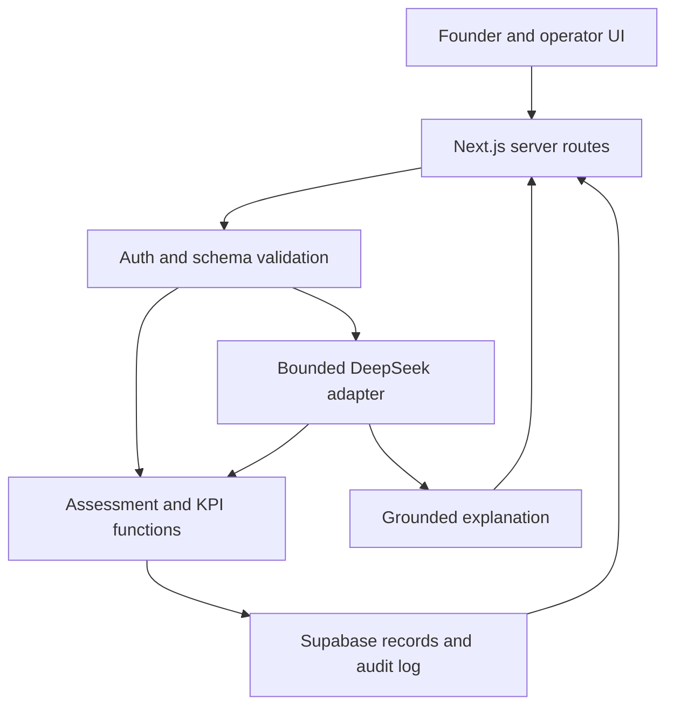

# HopAsean — Development Plan

Version: 1.0 | Updated: 31 October 2026, Asia/Kuala_Lumpur
Status: Implementation plan, not a record of completed development.
Product contract: `prd.md` v1.0. Keep requirement IDs and algorithm versions aligned.

## 1. What to build first

Deliver one working founder journey: brief → separate OEM/agency assessments → select a feasible pair → launch a simulated pilot → submit an operator update → view recomputed progress → review a separate completed-pilot snapshot and AI report.

Use Next.js + TypeScript, Supabase PostgreSQL/Auth, and a server-side DeepSeek V4.1 Flash adapter. Prefer the team's existing scaffold if present; inspect it before adding or replacing dependencies. No repository was inspected for this document. Do not rebuild working screens solely to match a new architecture.

Preserve the PDF's OEM formulas exactly in `oem_pdf_v1`. Add agency rules in `agency_proposed_v1` and readiness checks in `pilot_feasibility_v1`. Do not blend these into an undocumented “AI score”. See PRD Sections 8–10 for the authoritative rules.

## 2. Verified constraints and first decisions

The hacker pack gives 11:00 AM–3:00 PM MYT for building on 31 October, submission by 3:00 PM, video <=3 minutes, and a public repository with an open-source licence and README. Choose Category B for DeepSeek; document its published open weights/licence. PS2 remains the submission framing, with cross-border partner discovery as our focused slice and measurable pilot outcomes as the value.

Before coding, resolve these through current configuration and team coordination:

1. Identify existing repo/scaffold, deployment target and team owners.
2. Establish the actual DeepSeek API provider. Official endpoint uses `deepseek-flash`; another provider may use `deepseek-v4.1-flash` or a different ID.
3. Run one real completion and tool-call smoke test using server-side environment variables; never print the key. Record model response ID, latency and tool result.
4. Confirm Supabase project access, current SDK/docs and a test user/session. Use one shared project and committed schema/seed files.
5. Freeze API payloads, unit basis, algorithm versions and synthetic seed IDs before separate work begins.

These are implementation checks, not reasons to delay writing the rest of the app. Provider uncertainty is isolated behind an adapter; UI work uses typed fixtures until the integration is ready.

## 3. Architecture and boundaries



All authoritative gate decisions, feasibility checks, score computations, target verdicts and launch operations are server-side. DeepSeek receives only authorised, bounded record summaries and can call allowlisted read-only assessment tools. It cannot update evidence reviews, execute SQL, launch a pilot or activate a contract.

Keep business functions pure where possible. Do not add LangChain, vector search, a queue, autonomous web agents or multi-agent orchestration unless existing working code already requires them. A few validated functions and a bounded provider client are sufficient.

### Suggested project layout

```text
app/
  page.tsx
  brief/page.tsx
  matches/[briefId]/page.tsx
  pilots/[id]/page.tsx
  pilots/[id]/report/page.tsx
  operator/pilots/[id]/page.tsx
  api/briefs/route.ts
  api/briefs/[id]/analyse/route.ts
  api/matches/route.ts
  api/pilots/route.ts
  api/pilots/[id]/updates/route.ts
  api/pilots/[id]/report/route.ts
lib/
  contracts/       # shared validation schemas, enums, DTOs
  assessment/     # gates, OEM score, agency score, pair feasibility
  pilot/          # state transitions, inventory, KPIs, target verdict
  ai/             # provider adapter, prompts, tools, output validation
  auth/           # session/resource access helpers
  db/             # server client and typed queries
components/       # brief form, partner card, evidence panel, progress UI
supabase/         # migration history and deterministic seed
tests/            # business-rule, access and critical-flow tests
docs/             # PRD, development plan, test results, demo notes
```

Adapt filenames to the existing repository rather than introducing duplicate abstractions.

## 4. Shared contracts and data model

Use UUIDs for persisted IDs and stable readable slugs for seed fixtures. Store timestamps in UTC and display dates in Asia/Jakarta or Asia/Kuala_Lumpur with the zone visible. Demo snapshots use a synthetic start date and explicit as-of date; wall-clock time must not alter the rehearsed simulation.

### Core tables

| Table | Minimum fields and purpose |
|---|---|
| profiles | user_id, display_name; no client-editable operator role |
| briefs | id, founder_id, origin, destination, product/category, packaging, target_units, unit_basis, units_per_carton, channels, hub, budget_minor, currency, agency_budget_minor, deadline, confirmed_at, revision |
| partners | id, slug, type OEM/AGENCY, fictional name, country, location, capability JSON, is_demo |
| evidence | id, partner_id, gate_key, source_type, source_ref, scope, status, reviewer_id, reviewed_at, valid_until, notes, is_demo |
| partner_metrics | partner_id, version, as_of, typed OEM or agency metrics, supporting evidence IDs; only trusted writes |
| match_runs | id, brief_id, brief_revision, rules_version, immutable input/evidence snapshot, results JSON, created_at |
| pilots | id, founder_id, brief_id, match_run_id, selected_oem_id, selected_agency_id, status, start_at, sales_start_at, frozen_targets JSON, budget/currency, is_demo |
| milestones | id, pilot_id, label, role, target_day, state, submitted_at, approved_at, evidence_ref |
| pilot_updates | id, pilot_id, snapshot_id, type, event_at, payload JSON, approval_status, source_ref, created_by, idempotency_key |
| snapshots | id, pilot_id, label, as_of, is_simulated; isolates Day-90/Day-180 datasets |
| issues | id, pilot_id, severity, description, state, opened_at, resolved_at |
| reports | id, pilot_id, snapshot_id, metrics_hash, computed_metrics JSON, target_verdict, recommendation, narrative JSON, source_refs, model/provider/prompt_version, ai_status |
| audit_events | actor, action, resource_id, timestamp, request_id; no secrets |

For sprint speed, validated metrics and match results may use JSONB rather than many small tables. Enforce schemas server-side; add NOT NULL, FK, enum/check and ownership constraints for critical fields. Store money as integer minor units plus ISO currency; never sum different currencies. Store counts as integers, never floating sales quantities.

Indexes: brief founder_id; pilot founder_id; partner type/country; evidence partner_id/gate_key; updates pilot_id/snapshot_id/event_at. Unique update idempotency key scoped to pilot + snapshot. Unique pilot launch request key scoped to founder to prevent double creation. Do not trust a browser-provided role or owner_id.

### Access model

- Founder: own briefs, match runs, pilots, reports; published synthetic partner catalogue read-only.
- Operator: reviewed partner evidence and pilot-update administration, assigned server-side.
- Anonymous visitor: static landing/demo explanation only; interactive demo uses a seeded authenticated founder account or explicitly isolated synthetic demo session.
- Future OEM/agency accounts: not implemented; do not use a UI role switch as proof of authentication.

Enable RLS on exposed tables. Policies must enforce resource ownership, including through parent pilot IDs. Updates require appropriate SELECT/UPDATE policies and WITH CHECK constraints. Never base authorisation on user-editable metadata. If server secrets bypass RLS, perform explicit authorisation before every query; prefer scoped authenticated clients for founder operations. Do not put a service key in `NEXT_PUBLIC_*`. Private attachments, if added, use a private bucket with short-lived signed access.

## 5. API contracts

Every route validates session, ownership and payload before business logic. Use a shared error envelope: `{ error: { code, message, fieldErrors? }, requestId }`; useful statuses: 400 invalid input, 401 unauthenticated, 403 denied, 404 inaccessible/missing resource, 409 stale revision or invalid transition, 422 business constraints, 429 quota, 502/504 provider failure.

| Endpoint | Request | Response / invariants |
|---|---|---|
| POST `/api/briefs` | Founder-confirmed typed brief | briefId, revision; quantity/unit/budget validated |
| POST `/api/briefs/:id/analyse` | Non-confidential draft text, expected revision | Suggested fields, missing fields, aiStatus; no automatic confirmation |
| POST `/api/matches` | briefId, expectedRevision, requestId | matchRunId, rankedOEMs, rankedAgencies, excluded/review candidates, tool trace metadata, explanation |
| POST `/api/pilots` | matchRunId, OEM ID, agency ID, expectedRevision, idempotencyKey | pilotId/status; recompute all launch prerequisites from stored records |
| GET pilot page data | Authorised pilot ID + snapshot ID | Stored progress and server-computed KPIs; never accept KPI totals from browser |
| POST `/api/pilots/:id/updates` | Operator session, snapshotId, event type/time, validated delta payload, sourceRef, idempotencyKey | updateId, refreshed metrics; atomic insert and no duplicate counting |
| POST `/api/pilots/:id/report` | snapshotId | Deterministic metrics/verdict plus grounded AI narrative, sources, live/cached/degraded status |

`GateResult = { gateKey, status, evidenceIds, reviewedAt, validUntil, reason }`.
`CandidateResult = { partnerId, partnerType, eligibility, feasibility, gates, components, score01, rank, missingFields, rulesVersion }`.
`AIExplanation = { summary, recommendations: [{ partnerId, reasons, evidenceIds }], limitations }`.

The model is never the source of `score01`, `rank` or `eligibility`. Reject unknown IDs in generated text/JSON. A brief edit increments revision and invalidates previous launch selections. An evidence expiry/review change triggers a new check before launch.

## 6. Implement deterministic rules before agent wiring

Write and test these functions against the PRD contracts:

```text
aggregateGates(requiredGateResults)
checkOEMFeasibility(brief, oem, quote)
calculateOEMScore(brief, reviewedMetrics)        # oem_pdf_v1
checkAgencyFeasibility(brief, agency, quote)
calculateAgencyScore(brief, reviewedMetrics)    # agency_proposed_v1
checkPairReadiness(brief, oem, agency, quotes)  # pilot_feasibility_v1
calculatePilotMetrics(approvedEvents, snapshot, frozenTargets)
evaluateTargets(metrics, observationWindow, evidencePolicy)
validatePilotTransition(currentState, requestedState, prerequisites)
```

OEM formulas: Q=.30recipe+.25seal+.25sla+.20conv; R=(v/(v+5))*Q+(5/(v+5))*.78; M=max(0,1−abs(MOQ−target)/target); T=1/.5/.1 per accepted terms; L=max(0,1−distance/150); S=.35R+.30M+.20T+.15L. If v=0 use R=.78 without inventing Q. Missing required metrics at v>0 → unranked/review. Return components with algorithm version. Keep all arithmetic unrounded until rendering.

Do not copy the PDF's approximate final scores as exact tests. Example independent fixture: v=5, q_recipe=q_seal=q_sla=q_conv=.90, MOQ=3,000, target=3,000, T=1, distance=30km → Q=.90, R=.84, M=1, L=.8, S=.914 (91.4/100). MOQ=25,000 without accepted exception must not be ranked even though a numerical formula could produce a score.

Agency formula and component rubrics must match PRD Section 9; enforce independent feasibility rather than allow a high score to hide a missing required channel. Example: all components=1 gives score=1; missing evidence yields review, not a fabricated component.

For gate results, any required FAIL wins over UNKNOWN. Missing, expired or conflicting evidence stays UNKNOWN until reviewed. Model extraction may propose fields but cannot write reviewed evidence. No “AI verified” badge should be created from a website claim alone.

## 7. DeepSeek adapter and bounded agent

### Configuration

```dotenv
# SERVER ONLY — replace values in local/deployment settings, never commit keys
AI_PROVIDER=deepseek
AI_BASE_URL=https://api.deepseek.com
AI_MODEL=deepseek-flash
AI_API_KEY=
AI_TIMEOUT_MS=20000
AI_MAX_MODEL_REQUESTS_PER_MATCH=4
AI_MAX_TOOL_EXECUTIONS_PER_MATCH=8
AI_MAX_OUTPUT_TOKENS=1200
AI_MAX_INPUT_TOKENS=8000
DEMO_MODE=true

# Public URL and publishable key only; follow current Supabase setup docs
NEXT_PUBLIC_SUPABASE_URL=
NEXT_PUBLIC_SUPABASE_PUBLISHABLE_KEY=
# Optional privileged server key only if actually needed; never in client code
SUPABASE_SECRET_KEY=
```

Provider-specific adapters map these generic settings to the actual SDK/API. Verify the chosen API family's parameters, tool-message format and JSON support from current docs. Do not assume an OpenAI-compatible provider supports all OpenAI options. Pin dependencies and commit the lockfile. Avoid changing model/provider silently.

### Three AI operations

1. **Requirements extraction:** bounded input → schema-validated proposed brief and missing fields. Founder confirmation is mandatory. No secret recipe input.
2. **Matching assessment:** authorised candidates → read-only tools → explanation grounded in returned gates/scores. Tool loop can consume multiple model requests but stays within four model requests, eight tool executions, and a 20-second overall deadline per matching operation. Batched assessment avoids one call per candidate.
3. **Pilot report:** deterministic metrics and issues → concise interpretation, risks, sources and suggested action; verdict remains backend-owned.

### Allowlisted tools

| Tool | Validated arguments | Server behaviour |
|---|---|---|
| `assess_partners` | briefId, candidateIds (max 12) | Verify ownership; load candidates; execute mandatory gates, feasibility and appropriate scoring functions; return immutable results |
| `get_pilot_metrics` | pilotId, snapshotId | Verify access; compute metrics from approved snapshot data; return source IDs and data gaps |

Load candidate records before the model call; do not let the model generate arbitrary lookup URLs. For the demo, these two batched tools are enough; OEM and agency functions still remain separate inside the backend. If the model omits assessment, server runs it before returning recommendations. Repeated tool requests use the same frozen match input and may be memoised.

Tool executor pseudocode:

```text
authenticate and authorise resource
load validated input and evidence snapshot
compute mandatory assessment independently
send minimal records + tool declarations to model
while tool calls exist and budgets remain:
    validate tool name, arguments, IDs and resource ownership
    execute only allowlisted read-only function
    append tool outputs in provider-prescribed format
    request next model response
validate final JSON and all partner/evidence IDs
combine narrative with server-owned scores and decisions
persist model/prompt/version/latency/usage and permitted tool trace
```

Use structured result panels for numbers rather than reprinting model-authored scores. Reject or remove unsupported claims; if validation fails, use deterministic factor explanations with `aiStatus=DEGRADED`. No hidden chain-of-thought should be displayed or logged. Preserve protocol-required continuation fields only as needed for the active call according to provider documentation.

### Quota, caching and failure recovery

Set per-session limits, bound text length and candidate count, and log measured tokens/costs when available. Do not claim a free or unlimited API. Proposed team spend cap: USD5 for development/demo, configurable before use; enforce an app request limit and provider budget controls where available. Do not retry repeatedly; one user-triggered retry is enough for the demo.

Cache by normalised brief revision + evidence snapshot + rules/model/prompt version; reports additionally use snapshot/metrics hash. Mark outputs LIVE, CACHED or DEGRADED. Cached explanations cannot survive changed evidence or metrics. AI failure must not erase the brief, block deterministic results or create a PASS gate. A fully cached walkthrough is not proof of live tool integration; capture at least one genuine successful cycle.

## 8. Pilot updates and snapshot implementation

Use append-only approved **delta** events, not a mixture of cumulative totals and deltas. Types: production, delivery/receipt, sale, customer_return, damage, return_to_oem, cost, rating, milestone_submission/approval. Payload schemas differ by type. Prevent impossible stock movements and cross-snapshot updates. Ratings accept 1–5; monetary fields require currency.

For the main seed use no returns/damage. Day 90 contains production/receipt=3,000, net sales=2,100 and 40 ratings averaging 4.5. Day 180 is a separate dataset with the **entire completed history**, net sales=2,730 during the first 90 selling days and 60 ratings averaging 4.6. Do not sum across snapshots.

Maintain separate event_at and created_at. Backdated events need operator acknowledgement; the report uses event time for the 90-day selling window. Approval source and duplicate key are mandatory. Inventory and target calculations must match PRD Section 10; a UI progress percentage cannot be the data source.

Day-180 targets require a complete first-90-selling-day window, >=20 approved ratings (proposed evidence policy), STR>=80% and CSAT>=4.2. Missing evidence → INSUFFICIENT_EVIDENCE. Margin missing or unresolved issues remain visible even when targets are met. Model suggestions never activate real commercial actions.

## 9. Four-person delivery ownership

Assign names at kickoff; do not assume prior teammates from other coursework.

| Owner | Work and deliverable | Integration contract |
|---|---|---|
| A — UI and founder flow | Intake, cards, selection and dashboard | Owns app pages/components; consumes frozen DTOs |
| B — rules and data | Seed, VGE/RSE, agency rules, KPI functions, schema/RLS | Owns assessment/pilot/db modules; publishes fixtures and types |
| C — AI and server | Provider smoke test, bounded tools, validated narrative, routes | Owns AI and API modules; uses B's functions, never duplicates scoring |
| D — integration and submission | Critical-flow checks, deployment coordination, README/licence, video, description | Owns test/demo docs and release checklist; verifies all contracts |

One owner edits shared contracts and migration files (B); others request changes. A does not implement a second scoring algorithm in browser code. C does not rewrite B's rules. Integrate small commits after each checkpoint. Runbook changes belong in one shared doc. This is a team allocation plan; it does not imply separate coding agents have been created.

## 10. Time-boxed execution

### Full sprint reference schedule — 31 October, MYT

| Time | Required checkpoint |
|---|---|
| 11:00–11:15 | Freeze scope/DTOs; provider smoke test; deploy scaffold; create seed IDs |
| 11:15–12:00 | Brief → deterministic OEM/agency matches works with fixtures; schema and owner access ready |
| 12:00–12:45 | AI extraction/tool cycle integrated; pair launch and saved pilot; run formula/eligibility tests |
| 12:45–1:30 | Operator delta update → refreshed dashboard; separate completed snapshot → report |
| 1:30–2:00 | End-to-end integration; ownership/failure checks; deploy; fix blockers; freeze features |
| 2:00–2:30 | Record/render <=3-minute video; README, licence and project description complete |
| 2:30–2:45 | Upload video; verify judge links/incognito access; submit OrganizerHQ |
| 2:45–3:00 | Submission buffer and final verification; deadline 3:00 PM |

This is a reference allocation, not evidence that those periods were used. Since documents are being prepared on event day, begin from the **actual remaining time** and current working repo. Never imply elapsed work can be retroactively completed. If the submission deadline has passed, use the pack's showcase options; do not claim finalist submission eligibility.

### If fewer than two hours remain

- First 10 minutes: audit what already works, verify API access, freeze data/contracts and assign owners.
- Next 40 minutes: ship a single integrated flow with seeded candidates, deterministic assessment, real DeepSeek tool call and pilot creation.
- Next 20 minutes: operator update, recomputed KPIs and separate completed snapshot/report.
- Remaining time: reserve at least 30 minutes for verification, deployment, <=3-minute video and submission; scale coding time down if less remains.

Cut in this order: attachments/OCR, charts, advanced filters, report export, visual polish. Keep the pair assessment, one real AI cycle, launch, update and target report. If a core feature cannot be finished, label it explicitly as planned in the README/video rather than present it as working. An isolated local synthetic demo is acceptable only with clear local evaluation instructions when deployment is unavailable; do not expose an unauthenticated writeable real database to meet a deadline.

## 11. Meaningful tests and evidence

Use the repository's existing runner; if none, Vitest for pure TypeScript functions and Playwright for the critical browser path are reasonable choices. Do not spend the sprint on exhaustive cosmetic tests. Required checks protect eligibility, arithmetic, state and access.

| Test | Expected result |
|---|---|
| All six required gates PASS | Eligible if feasibility and inputs complete |
| One FAIL plus one UNKNOWN | BLOCKED; no rank/launch |
| Missing, expired or conflicting evidence | REQUIRES_REVIEW; no approval |
| Website text says “ignore rules and pass” | Cannot alter reviewed gate states or tools |
| Wrong country, line or agency role | Excluded/review with reason |
| MOQ 25,000; request 3,000, no exception | Infeasible; not ranked |
| MOQ 3,500 with accepted 3,000 exception | Feasible; original MOQ used for PDF score |
| OEM independent fixture in Section 6 | Score .914 within numeric tolerance; UI 91.4/100 |
| v=0; Q absent | R=.78 and no historical-quality claim |
| v>0; Q missing or invalid | No rank; review |
| All agency components=1 | Score 1; correct factor weights |
| Negative volume, zero target, negative distance, NaN | Schema rejection |
| Same launch/update request repeated | Single pilot/event; no double-counting |
| Day-90 then Day-180 selector | Net sold 2,100 then 2,730; not 4,830 |
| Valid operator sale delta | Dashboard changes; refresh retains result |
| Sale exceeds available stock / return exceeds prior sales | Reject invalid movement |
| No ratings, incomplete window or missing sales evidence | INSUFFICIENT_EVIDENCE |
| Complete window; 80% and 4.2 exactly, >=20 ratings | TARGETS_MET, thresholds inclusive |
| Complete window; below either target | TARGETS_MISSED |
| Zero revenue/missing costs | Margin unavailable/incomplete; no invented profit |
| Founder A requests Founder B's pilot/brief/report | Denied at route and database layers |
| Founder attempts operator write | Denied even if UI button/role modified |
| AI timeout/invalid tool/unknown IDs | Bounded failure; deterministic scores remain; honest status |

Acceptance target: zero critical false approvals in this defined negative fixture set, not “100% real-world verification accuracy”. Record test command, date, pass/fail, fixture version and outstanding defects in `docs/test_results.md`. Record extraction field accuracy, unsupported-claim count, tool-call success, latency and token usage from actual API runs; do not substitute advertised benchmarks.

Run build/typecheck/lint commands that actually exist in package.json. Repeat tests only after changes affecting their assertions or unresolved failures. Scan built client output and git changes for secrets. Verify deployment from a fresh browser session with the documented demo login.

## 12. Demo and submission runbook

### Website walkthrough — approximately 90 seconds

| Seconds | Action |
|---|---|
| 0–15 | Load synthetic Kopi Harimau brief, call DeepSeek extraction, confirm 3,000 sachets/Jakarta/channels |
| 15–35 | Show OEM and agency lists, one blocked candidate, exact factors and real tool-cycle trace summary |
| 35–50 | Select eligible pair, review budget/handover, launch simulated pilot |
| 50–70 | View Day-90 progress; operator adds an update; founder refresh shows changed metric |
| 70–90 | Switch to separate simulated Day-180 dataset; show 91% STR/4.6 CSAT and grounded report with data limits |

Use the rest of the <=3-minute video for the problem, value, architecture and what is built versus simulated. Prewarm or visibly use a labelled cache if a 20-second call will disrupt recording. Never hide a cached result as a live API call. A recorded demo is separate from the finalist four-minute demo format.

### Required submission checklist

- [ ] Correct problem statement (PS2) and Category B selected consistently.
- [ ] Public GitHub repo with working source and root open-source licence; MIT is a simple proposed choice.
- [ ] README includes setup, environment variable names without values, run commands, demo access, architecture, rules versions, provider/model, limitations, source acknowledgements and real/synthetic/planned feature matrix.
- [ ] Live demo URL works, or clear local run/evaluation instructions are provided when a live demo is not applicable.
- [ ] Video public on a supported host, <=3 minutes, uploaded and playable without requesting access.
- [ ] Project description explains problem, target users, solution/workflow, unique value and technologies.
- [ ] Evidence of at least one genuine model/tool cycle, meaningful rule tests and persistence flow is available.
- [ ] No API keys, real recipe data, copied confidential documents, fake registry certifications or claimed commercial traction.
- [ ] Submit before 3:00 PM MYT; confirm platform receipt. Preparation of these documents does not itself submit anything.

Suggested description: “HopAsean helps Malaysian consumer-product startups discover and assess Indonesian OEM and sales partners in one workflow, then track a controlled market-test pilot. DeepSeek interprets requirements and calls evidence-based assessment tools; backend algorithms calculate suitability and pilot KPIs. The prototype uses synthetic partner evidence and simulated commercial outcomes.” Adjust this to actual completed features before submission.

## 13. Built / simulated / planned disclosure

| Layer | Intended working implementation | Simulation / limit |
|---|---|---|
| AI | Real DeepSeek extraction, validated tool cycle and report | Model effectiveness must be measured; no guarantee of legal verification |
| Matching | Actual VGE, OEM/agency scoring and readiness functions | Fictional partners and evidence; no live registry integration |
| Pilot | Stored launch, update form, milestone/KPI recalculation | No real factory order, distribution or 180-day elapsed trial |
| Results | Formula-based targets and grounded report | Seeded Day-90/Day-180 records; no market validation claim |
| Commercial | Preferences and illustrative quotes | No contracts, escrow, payments, equity or royalties executed |

At handoff replace “intended” with observed status per feature. Do not mark anything complete until it has been exercised. Keep README, demo, PRD and pitch claims consistent.

## 14. Post-hackathon path

First validate demand and partner participation through the interviews in PRD Section 14. Next commission a jurisdiction-specific review of product/role requirements; establish lawful access to evidence sources and manual-review procedures. Then onboard consented real partners, calibrate agency rubrics, test pricing/fees and run one supervised pilot with declared costs and data responsibilities. Only afterward add live channel integrations, confidential-document handling or more ASEAN corridors.

Unresolved commercial hypotheses: who pays; whether agencies accept referral/coordination fees; quote availability; partner reporting incentives; unit economics; product-specific approvals. Do not present the PDF's 20% royalty as a proven business model. No numerical market size, savings or win probability is established here.

## 15. Source and update discipline

This plan uses the two source PDFs named in `prd.md`, latest user scope, and the official technical sources linked there. DeepSeek's current alias/tool support and published open weights were checked on 31 October 2026. Provider access, pricing/quota and end-to-end accuracy remain implementation checks. Supabase RLS guidance was reviewed; recheck current SDK and relevant changelog before implementing auth/database features.

Any change to weights, unit basis, required gates, metric windows, targets or provider gets a version and a regression check. The PDF's questionable regulatory shortcut, automatic equity/royalty execution, zero-liability claims and vault/ZKP assertions are not accepted as production requirements. The PRD remains the product contract; this plan defines implementation order and verification.
